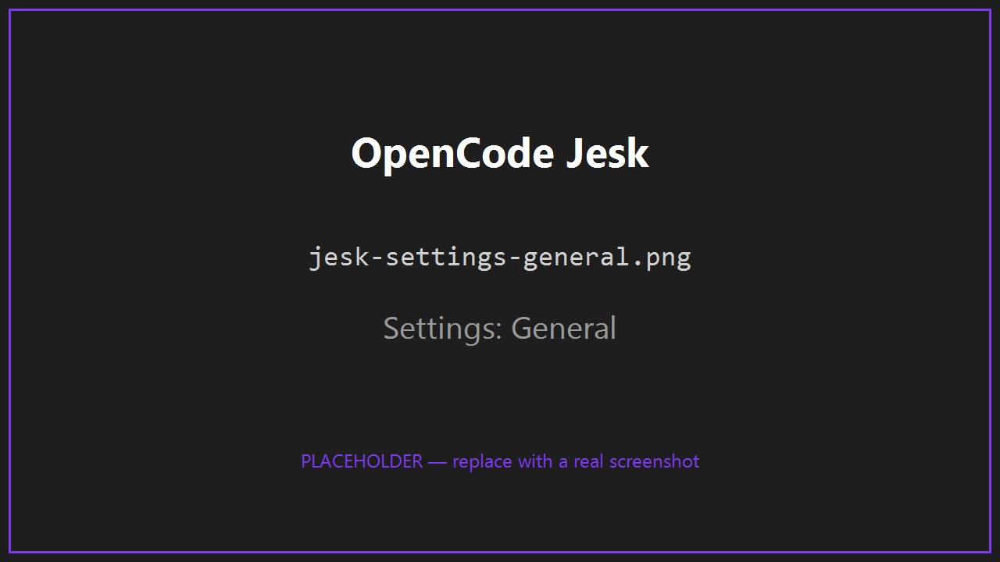
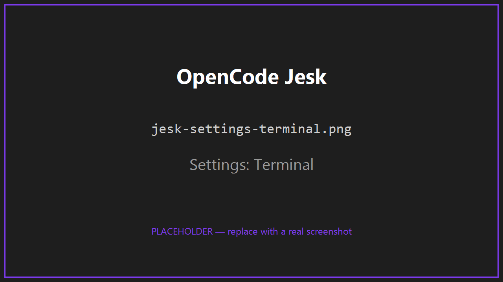
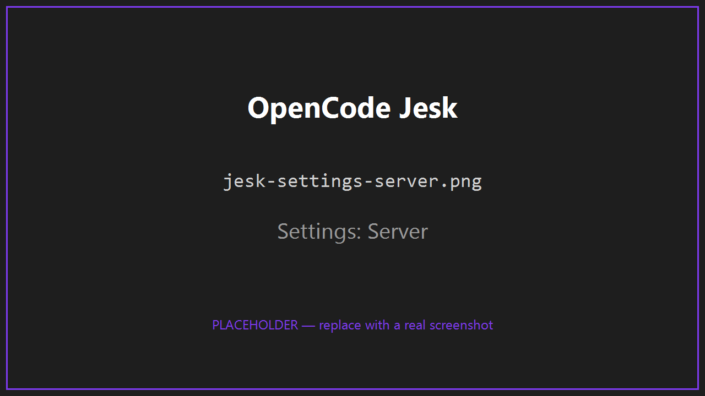
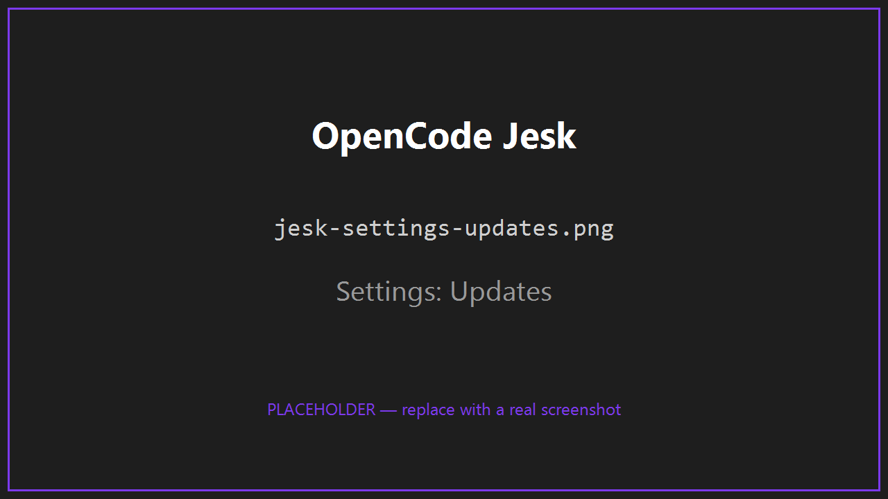
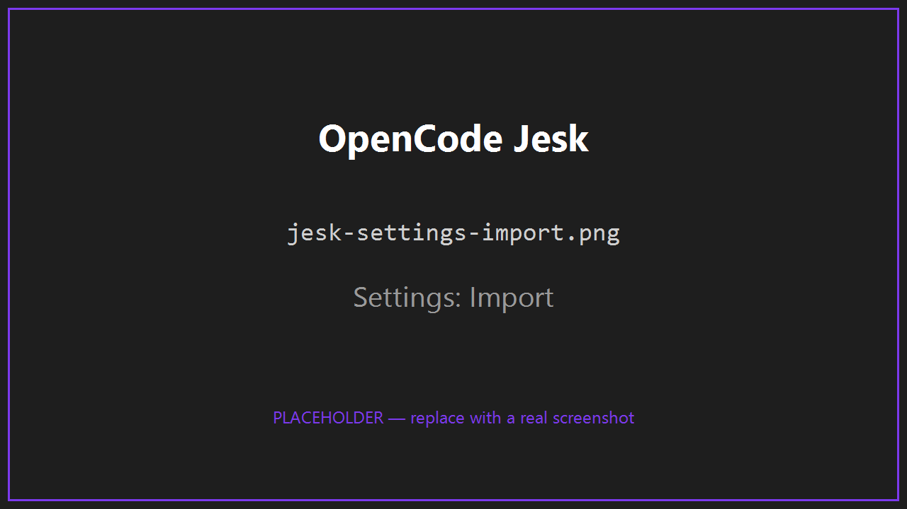
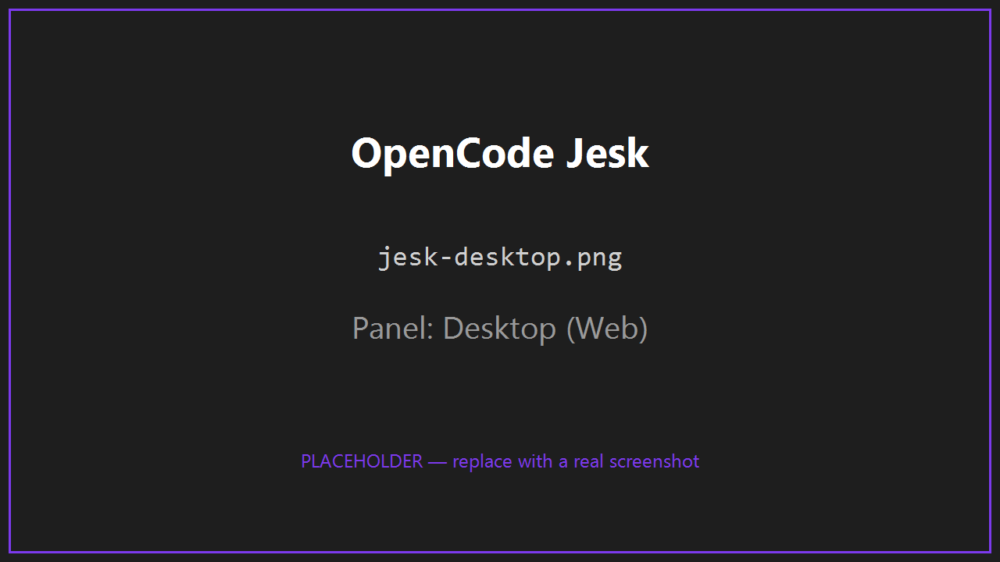
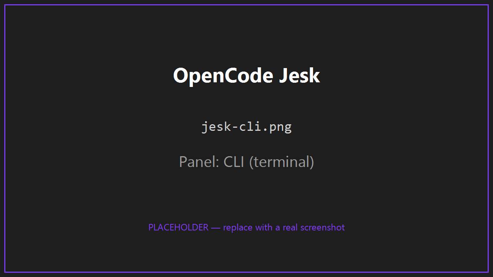

<div align="center">


# 🟣 OpenCode Jesk

**OpenCode-агент — прямо внутри Visual Studio.**

*Ранее OpenCode Studio. Быстрое, самодостаточное окно-инструмент с мастером настроек/переноса и общей историей чатов.*

[](https://marketplace.visualstudio.com/items?itemName=jevkray.OpenCodeJesk)
[](https://marketplace.visualstudio.com/items?itemName=jevkray.OpenCodeJesk)
[](https://marketplace.visualstudio.com/items?itemName=jevkray.OpenCodeJesk)


**[English](README.md) · [Русский](README.ru.md)**

</div>

---

> [!IMPORTANT]
> **Переименование: OpenCode Studio → OpenCode Jesk.** Это то же расширение под новым именем, оно полностью совместимо — настройки, провайдеры, ключи и история чатов сохраняются. **Поддержка OpenCode Studio завершается 20.10.2026.** Пожалуйста, перейдите на новое [OpenCode Jesk в Visual Studio Marketplace](https://marketplace.visualstudio.com/items?itemName=jevkray.OpenCodeJesk).

> [!TIP]
> **Одно окружение — везде.** OpenCode Jesk использует те же данные, что OpenCode CLI и desktop-приложение — провайдеры, настройки, ключи и **все чаты** уже на месте. Никакой настройки и дублирования.

## 🆕 Что нового

- **1.2.0** - Режимы интерфейса **Desktop (Web)** и **CLI (терминал)** в одной панели; общий чат между режимами; отдельное окно **Settings** (Основные, Терминал, Сервер, Обновления, Импорт); авто-открытие при открытии решения; **масштаб веб-панели**; шрифт, размер, курсор и строки истории терминала; порт/аргументы/остановка сервера по простою; проверка обновлений в Marketplace; поддержка **v1 / v2 preview**; безопасный импорт с резервными копиями; и переименование в **OpenCode Jesk**.
- **1.1.5.1** (минорный хотфикс) - Надёжнее открывается **Open Extension Manager** (менеджер расширений Visual Studio, сначала вкладка Updates); окно обновления теперь скрывается до следующего перезапуска Visual Studio при любом действии и подсказывает, как отключить уведомления в настройках.
- **1.1.5** - Исправлено: закрытие окна обновления прячет его до следующего перезапуска; «Open Extension Manager» открывает диспетчер расширений Visual Studio.
- **1.1.4** - Фоновая проверка обновлений (раз в минуту). Для **самого OpenCode Jesk**: компактное тёмное окно показывает новую версию и список изменений с кнопками **Open Extension Manager** / **Marketplace page** / **Not now** (Visual Studio и так ставит обновления расширений в фоне). Для **OpenCode CLI**: окно предлагает обновить прямо из расширения (`npm i -g opencode-ai@latest`) или показывает команду вручную; панель подхватит новую версию при перезапуске. Новая настройка **Check for new versions** отключает уведомления об обновлении расширения.
- **1.1.3** - Окно Settings показывает установленную и последнюю доступную версию OpenCode и кнопку **Update**, если вышла новая. Новая версия подхватывается автоматически.
- **1.1.2**
  - Всегда используется **последняя установленная версия opencode**: при старте сервер заново проверяет бинарь (путь + время изменения) и перезапускается, если он обновился; в `server.json` теперь пишется реальный PID серверного процесса.
  - Мастер первого запуска превращён в окно **Settings** с вкладками **Import** и **Settings**; кнопка — **Save selected** (применяет и импорт, и настройки).
- **1.1.0** - Кнопка статистики в панели OpenCode: профиль и реальные траты, не выходя из Visual Studio.

## 📸 Скриншоты

<!-- SCREENSHOT: docs/images/jesk-settings-general.png — Settings: Основные (режим интерфейса, версия OpenCode, масштаб, поведение панели) -->

*Settings — Основные: режим интерфейса, версия OpenCode, масштаб веб-панели и поведение панели.*

<!-- SCREENSHOT: docs/images/jesk-settings-terminal.png — Settings: Терминал (шрифт, размер, курсор, история, аргументы CLI) -->

*Settings — Терминал: шрифт, размер, курсор, строки истории и параметры команды CLI.*

<!-- SCREENSHOT: docs/images/jesk-settings-server.png — Settings: Сервер (путь к бинарнику, порт, аргументы serve, простой) -->

*Settings — Сервер: путь к бинарнику opencode, порт, аргументы serve и остановка после простоя.*

<!-- SCREENSHOT: docs/images/jesk-settings-updates.png — Settings: Обновления (проверка, интервал, канал) -->

*Settings — Обновления: проверка новых версий, интервал и канал выпусков.*

<!-- SCREENSHOT: docs/images/jesk-settings-import.png — Settings: Импорт (найденные источники, добавить папку, импорт) -->

*Settings — Импорт: найденные источники OpenCode, добавление папки и импорт выбранного (с резервными копиями).*

<!-- SCREENSHOT: docs/images/jesk-desktop.png — Панель в режиме Desktop (Web) -->

*Панель в режиме **Desktop (Web)** — полный веб-интерфейс OpenCode внутри окна-инструмента.*

<!-- SCREENSHOT: docs/images/jesk-cli.png — Панель в режиме CLI (терминал) -->

*Панель в режиме **CLI (терминал)** — простое окно терминала с уже запущенным OpenCode.*

## ✨ Почему OpenCode Jesk?

| | |
|---|---|
| 🧠 | **Настоящий OpenCode, а не клон** — полный официальный веб-UI прямо в Visual Studio. |
| 🔄 | **Общая история** — те же чаты, что в CLI и desktop, во всех окнах Visual Studio. |
| 🗂️ | **Текущий проект по умолчанию** — форма нового чата выбирает открытое решение/репозиторий Visual Studio; другие проекты и чаты остаются доступны. |
| ⌨️ | **Desktop / CLI** — веб-панель или простое окно терминала с уже запущенным OpenCode внутри той же панели, для v1 и v2 preview. |
| 📈 | **Профиль и расход в один клик** — кнопка статистики открывает консоль OpenCode прямо в панели: реальные траты и лимиты без переключения в браузер. |
| 📥 | **Настройки и мастер переноса** — импорт настроек, тем, ключей и истории в один клик. |
| 🔁 | **Авто-переподключение** — само восстанавливает сессию при обрыве связи. |
| 🔒 | **Локально** — только loopback, ноль телеметрии. |
| 🪶 | **Лёгкий** — один VSIX для Visual Studio 2022 и 2026. |

- ⚙️ **Переключатель проверки обновлений** — включить или отключить уведомления об обновлениях в настройках.

## ⌨️ Web и CLI

Режим выбирается только в **Settings → Settings → Interface**: **Desktop (Web)** или **CLI**. Переключателя в самой панели нет. Настройка **Use OpenCode v2.x (preview)** независима и действует на оба интерфейса.

Desktop сохраняет существующую интеграцию WebView2. CLI показывает простое окно терминала с уже запущенным OpenCode — без хрома терминала Visual Studio и лишнего интерфейса, только терминал и агент. Терминал живёт в той же панели OpenCode Jesk, поэтому Visual Studio сохраняет его положение и размер, а OpenCode запускается автоматически в папке проекта.

Оба режима подключаются к одному серверу. При переходе из Web в CLI можно продолжить выбранный чат. История общая в пределах выбранной версии OpenCode; автоматической конвертации БД v1/v2 нет. При открытии Jesk форма нового чата выбирает Git-корень решения либо папку решения, если репозитория нет.

Проверка: соберите Release и запустите `tests\Run-TerminalSmoke.ps1`. Проверка использует отдельные тестовые данные и охватывает терминал (ConPTY), общие сессии v1/v2 и отображение терминала в WebView2.

## 🚀 Быстрый старт

```text
  Вид      →  Другие окна          →  OpenCode Jesk          🔹 агент
  Сервис   →  OpenCode Jesk Settings                        📥 мастер настройки
```

> [!NOTE]
> **Требование:** [OpenCode CLI](https://opencode.ai) должен быть установлен и доступен в `PATH`.

<details>
<summary><b>📦 Установка</b></summary>

**Из Visual Studio Marketplace (рекомендуется)**

1. В Visual Studio откройте **Расширения → Управление расширениями**.
2. Найдите **OpenCode Jesk** и установите.
3. Перезапустите Visual Studio.

**Из VSIX-файла**

1. Скачайте последний `OpenCodeJesk-x.y.z.vsix` из [Releases](https://github.com/Jevkray/OpenCodeStudio/releases).
2. Закройте все окна Visual Studio и дважды кликните по файлу.

</details>

## 🔗 Синхронизация истории чатов

OpenCode хранит каждую сессию **в привязке к каталогу проекта**, в котором она создана. Поскольку OpenCode Jesk использует те же данные, что CLI и desktop, все чаты уже доступны — но сгруппированы по пути проекта.

> [!IMPORTANT]
> Если проект находится по **другому абсолютному пути**, чем при создании чатов (другой диск, другое имя пользователя, перемещённая или переименованная папка), сессии останутся привязаны к исходному пути. **Приведите пути проектов в соответствие — и всё синхронизируется.**

1. Открывайте каждый проект по **тому же абсолютному пути**, что использовался изначально — например `C:\Users\<вы>\source\repos\MyApp`.
2. Если путь изменился — верните проект на место либо перенесите старые данные через **Сервис → OpenCode Jesk Settings**, указав папку с исходным `opencode.db`.
3. Переоткройте окно-инструмент — сессии появятся у нужного проекта.

Как только пути совпадают, **все чаты синхронизируются** между CLI, desktop-приложением и всеми окнами Visual Studio. 🎉

## Статистика

Статистики в этом релизе пока нет. Используй кнопку статистики в панели OpenCode — она открывает OpenCode Console (расходы и лимиты) прямо внутри Visual Studio.

## 🧱 Архитектура

Ядро OpenCode Jesk намеренно компактное и разделённое.

```text
 ┌──────────────────────────────────────────────────────────────┐
 │  OpenCodeStudioPackage            пакет VS и команды         │
 ├──────────────────────────────────────────────────────────────┤
 │  ServerController                жизненный цикл сервера      │
 │    ├── OpenCodeServerService      запускает `opencode serve` │
 │    ├── OpenCodeSessionService     API /session, /project     │
 │    ├── ConnectionMonitor          периодические проверки     │
 │    └── ProcessBinding             завершается вместе с VS    │
 ├──────────────────────────────────────────────────────────────┤
 │  OpenCodeToolWindowControl        хост WebView2              │
 │    └── открывает http://127.0.0.1:<port>/ (главная веб-UI)   │
 ├──────────────────────────────────────────────────────────────┤
 │  SettingsWindow / ImportService   настройки и импорт         │
 │    └── OpenCodeEnvironment / Log                             │
 └──────────────────────────────────────────────────────────────┘
```

> [!TIP]
> **Принципы дизайна**
> - **Без прокси** — WebView2 работает с реальным адресом сервера, интерфейс истинный и не ломается при обновлениях.
> - **Общие данные** — запуск в вашем стандартном окружении, синхронно с CLI и desktop.
> - **Один сервер на машину** — все окна Visual Studio используют один сервер OpenCode.
> - **Локально по умолчанию** — только loopback, исходящих запросов нет, кроме ваших провайдеров.

## 🧩 Требования

| Компонент | Версия |
|---|---|
| 🖥️ Visual Studio | 2022 и 2026 |
| ⚡ OpenCode CLI | v1 и v2 (beta), установлен и в `PATH` |
| 🛠️ .NET SDK *(сборка из исходников)* | .NET 10 |
| 🌐 WebView2 Runtime | входит в Windows 10/11 и VS |

## 🔨 Сборка из исходников

```bash
git clone https://github.com/Jevkray/OpenCodeStudio.git
cd OpenCodeStudio
dotnet build vs/OpenCodeStudio.csproj -c Release
```

VSIX появится в `vs/bin/Release/net472/OpenCodeStudio.vsix`. Для сборки обоих брендов сразу (Studio и Jesk) запустите `build-both.ps1`. Для отладки откройте `OpenCodeStudio.sln` и нажмите **F5** (экспериментальный экземпляр). 🧪

## 🛡️ Приватность

- 🖧 сервер слушает только `127.0.0.1`
- 🔑 ключи хранит сам OpenCode в вашем окружении
- 🚫 нет телеметрии и аналитики
- 📈 оверлей использования входит в OpenCode Console и читает расход и лимиты с `opencode.ai` по вашей сессионной cookie (хранится зашифрованной через DPAPI) — другие данные наружу не уходят.

## 💬 Контакты и поддержка

<div align="center">

[](https://t.me/eugenekray)
[](mailto:krasovskyworks@gmail.com)
[](https://boosty.to/jevkray)
[](https://github.com/Jevkray/OpenCodeStudio/issues)

</div>

## 📜 Лицензия

Распространяется по лицензии [MIT](LICENSE).

<div align="center"><sub>Создано для сообщества OpenCode · Не связано с OpenCode или Microsoft.</sub></div>
